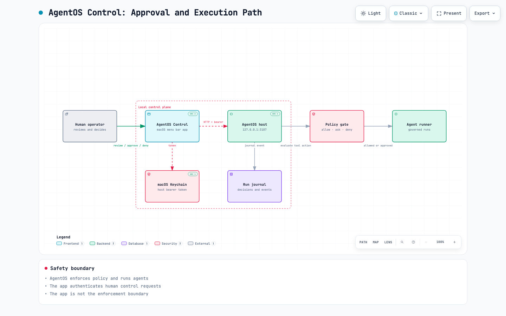

# AgentOS Control

AgentOS Control is a native macOS menu bar app for supervising coding agents managed by AgentOS. It brings pending approvals, run status, host health, agent activity, diffs, and selected control actions into one place, so a human can review and govern work without keeping the web cockpit open.

It addresses a practical failure mode: approval requests can expire when the web cockpit is not being watched. The app delivers those requests as macOS notifications, provides context for reviewing them, and requires local human authentication before approval.

## Project overview

AgentOS is the governed runtime; AgentOS Control is its macOS control surface. The app talks to the AgentOS host-v1 API on `127.0.0.1:3107`. It is not an agent runner or a replacement for the host's policy engine: the host remains responsible for enforcing policies and executing decisions.

The app can:

- Notify the user of pending approvals and let them approve or deny from the notification.
- Show runs, tasks, host health, agent dialogue, activity, diffs, commits, and other host-provided status.
- Expose guarded controls such as the kill switch, breaker reset, commands, cleanup, delegation, and promotion.
- Offer read-only observation mode with `--readOnly YES`.

## Architecture flow



[Download the standalone diagram HTML](./architecture.html) and open it in a browser for the interactive view.

The host evaluates and executes agent actions. AgentOS Control provides the human approval and observation surface.


## Safety approach

Safety is enforced as a chain between AgentOS and the app:

- **Host-side policy remains authoritative.** AgentOS classifies tool actions and decides which are automatic, require confirmation, or are forbidden. AgentOS Control does not replace or weaken those rules.
- **Control requests require the host token.** The app reads the bearer token from macOS Keychain for each control action and does not log it. If the token is unavailable, it sends no control request. The host API is loopback-only; status reads are unauthenticated, while control routes require authentication.
- **Approvals require local presence.** An approval can be sent only after macOS device-owner authentication succeeds (Touch ID where available, with the system authentication fallback). Denial does not require authentication. The approval state machine prevents duplicate or stale decisions and treats a decision made elsewhere as resolved.
- **Sensitive actions add review steps.** The kill switch and breaker reset require authentication. Cleanup shows the proposed fixed list before applying it and the host refuses a second application. Delegation displays the full text before authentication and launch; promotion names the affected project and conversation.
- **Actions are observable.** The app exposes runs, journal events, diffs, and commits supplied by the host. The host records decisions and control events in its journal.

These controls reduce accidental or unauthorized actions within the AgentOS workflow; they are not a guarantee against a compromised Mac, a malicious process running as the user, a compromised AgentOS host, or work performed outside AgentOS.

## Supporting evidence

The repository includes unit tests for the approval state machine, authentication flow, API request construction and decoding, notification handling, and other app behavior.

| Evidence | Result |
|---|---|
| Swift unit tests with simulated host, Keychain, and authentication | 387 tests in 41 suites passed; last recorded rerun: 2026-10-08 |
| End-to-end scenario E2E-17, 2026-09-24 | A governed Claude shell-command request appeared as a notification 0.5 s after the request. After approval and local authentication, the decision was sent 0.7 s after the click; the host receipt identified `human:jean`, and the run continued. |

These are recorded results, not a claim that the suite was rerun for every change. The E2E result covers one scenario on the recorded setup.

Representative tests:
- [Approval state machine and stale/duplicate decision handling](AgentOSControlTests/ApprovalStateMachineTests.swift)
- [Host API requests, bearer token handling, and response decoding](AgentOSControlTests/HostClientDecodingTests.swift)
- [Approval notification choices and presence-gated decisions](AgentOSControlTests/NetworkCardTests.swift)


## How it works

- `HostClient` is a Swift actor that speaks the frozen host-v1 API at `http://127.0.0.1:3107`. Reads are unauthenticated; control routes use the Keychain bearer token.
- Pending approvals are polled every 2 seconds. The approvals WebSocket announces resolutions and kill-switch changes. Notifications open the corresponding approval in the app.
- The approval state machine handles authentication delays, decisions made in another client, echoed socket events, and races between polling and a POST.
- Run dialogue panes are read-only. The host masks lines before sending them; the app strips control characters, caps each buffer at 2,000 lines, and renders the content as plain text.
- Diff and commit views display host-provided, redacted information. Secret-looking files are listed without their contents.
- Cleanup and delegation require the user to review the exact proposed items or text before the authenticated action is sent.

## Limitations

- **Single-machine scope:** the app targets macOS and a local AgentOS host. It is not a remote administration client or a general-purpose agent safety layer.
- **Host dependency:** the host must be running and reachable, and its policy, API, and token handling must be correctly configured. The app's UI is not the enforcement boundary.
- **Local trust boundary:** API traffic uses plain HTTP over loopback. Local status reads are unauthenticated, and the app cannot protect against a compromised host, user account, or another process with equivalent access.
- **Authentication fallback:** macOS device-owner authentication may allow the account password when Touch ID is unavailable; the app relies on the system authentication result.
- **Polling delay:** pending approvals are checked every 2 seconds, so notification delivery is not instantaneous or guaranteed.
- **Compatibility and distribution:** the app requires macOS 26+, Xcode 26+, and XcodeGen. The build uses ad hoc signing; no third-party dependencies are required.
- **Evidence age and scope:** the recorded test run is from 2026-10-08, and the E2E result covers one scenario from 2026-09-24. Neither establishes the absence of defects or covers every host failure mode.

## Build, test, install

```bash
xcodegen generate
xcodebuild test -project AgentOSControl.xcodeproj -scheme AgentOSControl -destination 'platform=macOS' -derivedDataPath build
Scripts/build_app.sh
open "/Applications/AgentOS.app" --args -readOnly YES   # optional: observe only, never acts
```

To install from source, run Scripts/build_app.sh. It builds the Release app, ad hoc signs it, and installs it at /Applications/AgentOS.app; if the older AgentOS Control.app exists, the script archives it. This README does not link to a downloadable signed release.

Requirements: macOS 26+, Xcode 26+, XcodeGen. No third-party dependency; the app is ad hoc signed.
